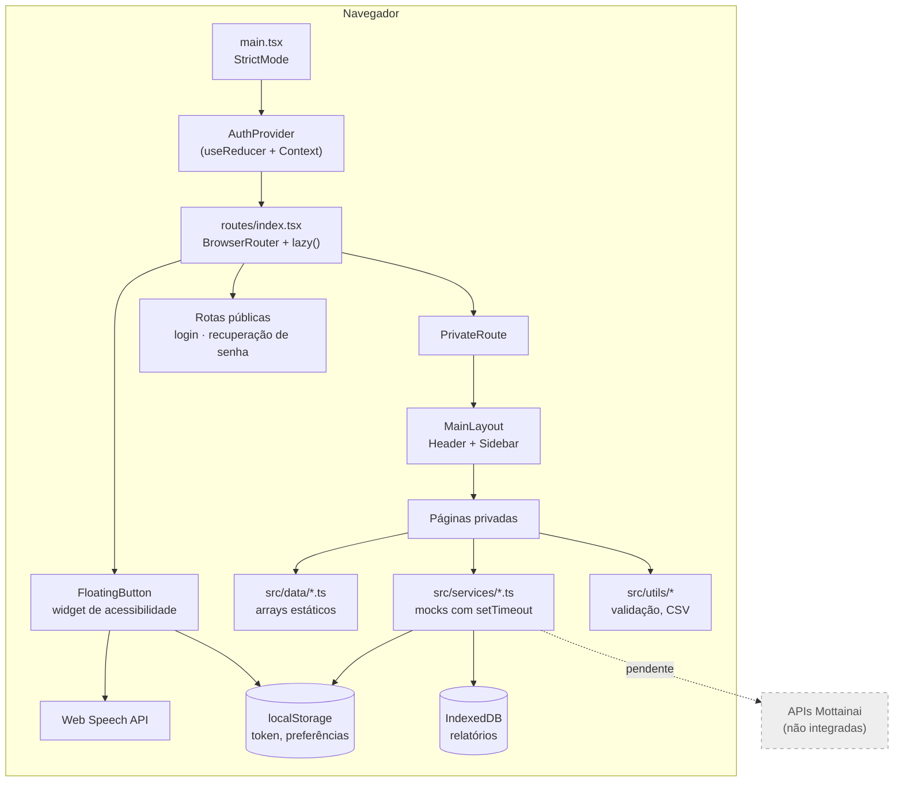
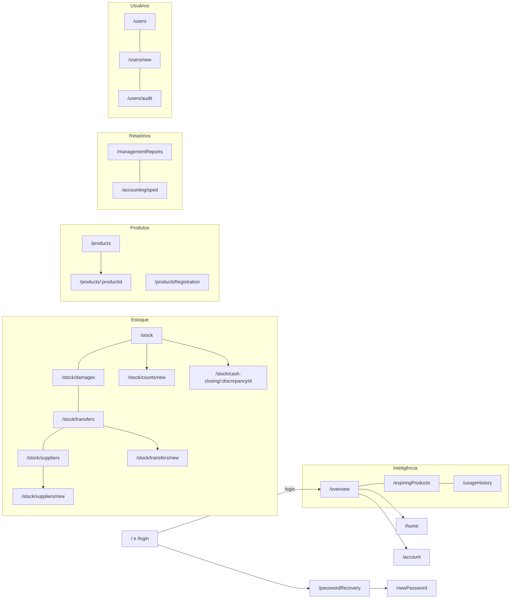
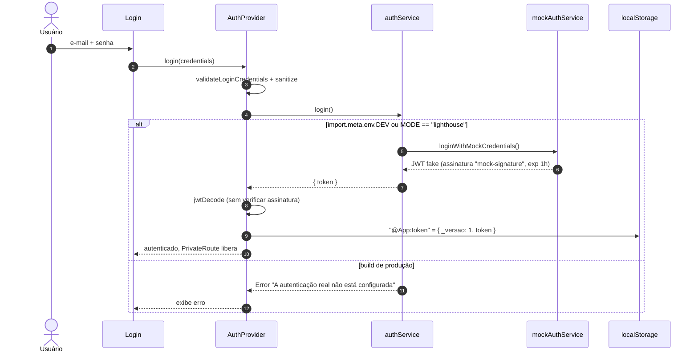
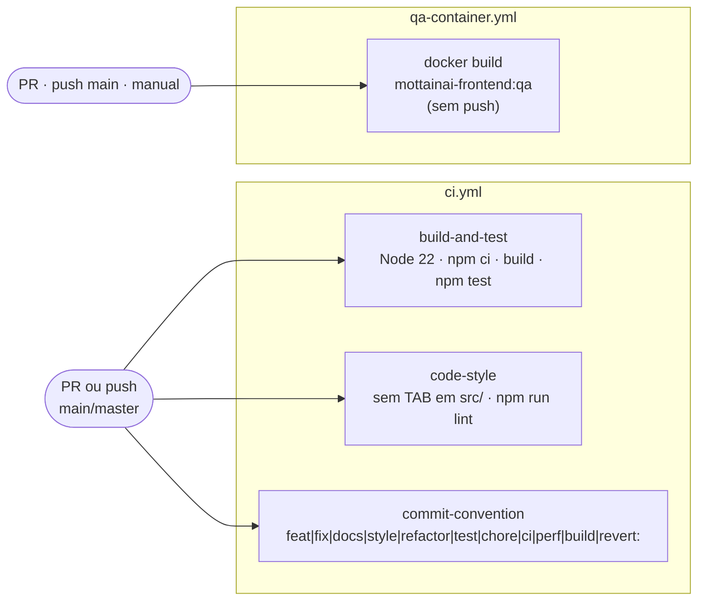

<div align="center">

# Mottainai Frontend

**Painel web administrativo do Mottainai: gestão preditiva de estoque para pequenos e médios varejos**

*SPA em React + TypeScript + Vite com telas de visão geral, alertas de vencimento, produtos, estoque, relatórios, contabilidade e usuários. Tem um widget de acessibilidade bem completo, mas hoje roda só com dados de demonstração.*

<br/>

[](https://react.dev/)
[](https://www.typescriptlang.org/)
[](https://vite.dev/)
[](https://reactrouter.com/)

[-5FA04E?style=flat-square&logo=nodedotjs&logoColor=white)](.github/workflows/ci.yml)
[](vitest.config.ts)
[](https://www.chartjs.org/)
[](eslint.config.js)
[](Dockerfile)
[](.github/workflows/ci.yml)
[](#2-estado-atual-do-projeto)

<br/>

[Visão geral](#1-visão-geral) •
[Estado atual](#2-estado-atual-do-projeto) •
[Arquitetura](#3-arquitetura) •
[Tecnologias](#4-tecnologias) •
[Telas](#6-funcionalidades-e-rotas) •
[Dados e integrações](#7-dados-integrações-e-autenticação) •
[Como rodar](#8-como-executar-localmente) •
[Testes e CI](#9-qualidade-testes-e-ci) •
[Riscos](#11-segurança-riscos-e-limitações)

</div>

---

## 1. Visão geral

O **Mottainai** (もったいない, expressão japonesa para *"que desperdício"*) é um sistema de gestão preditiva de estoque para varejo de pequeno e médio porte, organizado em vários repositórios na org [Mottainai-One](https://github.com/Mottainai-One) (APIs, frontend, mobiles, POS, BI, RPA e IA).

Este repositório guarda o **frontend web administrativo** (`sistema-mottainai` no `package.json`), voltado a gestores da loja. A interface cobre:

| Domínio | O que a interface oferece |
|---|---|
| **Inteligência / Motor** | Visão geral com "decisões do motor" nas últimas 24h, assertividade do motor e alertas de vencimento com ação sugerida |
| **Produtos** | Listagem, detalhe com histórico e cadastro (individual ou importação de arquivo XML/CSV) |
| **Estoque** | Inventário/contagem, avarias e consumo interno, transferências entre lojas, fornecedores e divergência de fechamento de caixa |
| **Relatórios e contabilidade** | Relatório gerencial de mais vendidos e relatório financeiro mensal (rotulado como SPED), ambos exportados em CSV |
| **Usuários** | Funcionários (papéis Gerente, Estoquista e Caixa) e log de auditoria |
| **Acessibilidade** | Botão flutuante com tema, contraste, fonte, espaçamento, filtros de visão de cores, leitura em voz alta e outros ajustes |

> [!IMPORTANT]
> Hoje a aplicação é um **protótipo navegável**. Não há nenhuma chamada HTTP no código-fonte. Todos os dados vêm de arquivos locais (`src/data/`), de arrays escritos direto nos componentes ou de serviços que simulam latência com `setTimeout`. Detalhes na [seção 7](#7-dados-integrações-e-autenticação).

---

## 2. Estado atual do projeto

Análise da branch **`main`**, a branch padrão observada (`origin/main`). Commit analisado: `5ca32b7` (*fix: Housekeeping*, 2026-10-26).

| Item | Status |
|---|:---:|
| Layout principal, sidebar, header e navegação por pastas |  |
| Telas de produtos, estoque, relatórios, contabilidade e usuários | -yellow?style=flat-square) |
| Widget de acessibilidade + leitura em voz alta (Web Speech API) |  |
| Validação e sanitização de formulários (`src/utils/*Validation.ts`) |  |
| Testes (node:test + Vitest) e CI de build, lint e convenção de commits |  |
| Imagem Docker de QA (Nginx) |  |
| Autenticação real (backend) |  |
| Integração com as APIs do Mottainai (produtos, estoque, motor de IA) |  |
| Deploy público |  |

<details>
<summary><b>Histórico recente da main (últimos commits)</b></summary>

<br/>

```text
5ca32b7 fix: Housekeeping
a3e5302 ci: build local frontend QA preview
b55f528 feat: add the accessibility button to the project
2a01d74 fix: fix the project to attend to the requirements
7e5efaa feat: add the administration of users in the project
e8d7558 feat: add the contability flow to the project
d60613e fix: fix the code to be more similar to the design
66408e9 feat: Transfer flow
493c331 feat: add the stock page
03f9019 feat: add the page habits of consume
c72ba13 feat: add the product flow
...
8de3dd7 feat: create home interface without true data
```

</details>

---

## 3. Arquitetura

### Visão de componentes



### Decisões observadas no código

| Decisão | Onde | Observação |
|---|---|---|
| Code splitting por rota | `src/routes/index.tsx` | Todas as páginas usam `lazy()` com `Suspense` e `Spinner` de fallback |
| Estado de auth com `useReducer` + Context | `src/context/AuthProvider.tsx` | Sem biblioteca de estado global. O resto é estado local de página (`useState`, `use-immer`) |
| Alias `@/` → `src/` | `vite.config.ts`, `tsconfig.app.json` | |
| CSS Modules por componente | `*/style.module.css` | Estilos globais em `src/styles/global.css` e `src/styles/accessibility.css` |
| Serviços assíncronos com `AbortSignal` | `historicalMetricService`, `rankingService` e hooks | Prontos para trocar o mock por `fetch` sem mexer nos hooks (inferência) |
| Persistência só no cliente | `managementReportService`, `monthlyFinancialReportService` | IndexedDB com retenção de 365 dias |

---

## 4. Tecnologias

<table>
<tr>
<td align="center" width="140"><br/><b>React 19.2.8</b><br/><sub>UI + react-dom</sub></td>
<td align="center" width="140"><br/><b>TypeScript 6.0.3</b><br/><sub><code>strict</code>, sem JS em <code>src/</code></sub></td>
<td align="center" width="140"><br/><b>Vite 8.2.0</b><br/><sub>Dev server e build<br/>(plugin-react 6.0.5)</sub></td>
<td align="center" width="140"><br/><b>React Router 7.18.2</b><br/><sub><code>react-router-dom</code></sub></td>
</tr>
<tr>
<td align="center" width="140"><br/><b>Chart.js 4.5.1</b><br/><sub>Donut e histórico</sub></td>
<td align="center" width="140"><br/><b>Font Awesome</b><br/><sub>Ícones solid</sub></td>
<td align="center" width="140"><br/><b>Immer 11.1.18</b><br/><sub>+ <code>use-immer</code></sub></td>
<td align="center" width="140"><br/><b>jwt-decode 4.0.0</b><br/><sub>Leitura do token<br/>(sem verificação)</sub></td>
</tr>
<tr>
<td align="center" width="140"><br/><b>Vitest 5.0.5</b><br/><sub>+ Testing Library<br/>+ jsdom</sub></td>
<td align="center" width="140"><br/><b>ESLint 9.39.5</b><br/><sub>typescript-eslint,<br/>react, jsx-a11y</sub></td>
<td align="center" width="140"><br/><b>Docker</b><br/><sub>node:22-alpine<br/>→ nginx:1.27-alpine</sub></td>
<td align="center" width="140"><br/><b>GitHub Actions</b><br/><sub>CI e imagem QA</sub></td>
</tr>
</table>

> [!NOTE]
> As versões acima são as **resolvidas no `package-lock.json`** (lockfileVersion 3). No `package.json` as dependências usam faixas `^`/`~`. Por exemplo, TypeScript aparece como `~6.0.2` e o lock resolve para `6.0.3`. Também estão nas devDependencies `@lhci/cli` 0.15.x e `puppeteer` 24.x, usados pela auditoria Lighthouse.

---

## 5. Estrutura do repositório

```text
Mottainai-Frontend/
├── .github/workflows/
│   ├── ci.yml                 # Build + testes, indentação + ESLint, convenção de commits
│   └── qa-container.yml       # docker build da imagem de QA (sem push)
├── .codex/reorder-css.mjs     # Script utilitário para reordenar propriedades CSS
├── qa/
│   ├── README.md              # Instruções da imagem de preview (em inglês)
│   └── nginx.conf             # Porta 8080, /healthz e fallback de SPA
├── public/robots.txt
├── src/
│   ├── assets/                # Fontes de acessibilidade (Andika, Arimo, Comic Neue, DejaVu, Lexend), logos, mascote lontra
│   ├── components/            # ~25 componentes (MainLayout, Sidebar, Header, ReusableTable, charts, modais, filtros...)
│   ├── config/                # folder-navigation.ts: abas de navegação por domínio
│   ├── context/               # AuthContext + AuthProvider
│   ├── data/                  # Dados de demonstração (produtos, estoque, contagens, transferências, fornecedores...)
│   ├── hooks/                 # useAuth, useHistoricalMetrics, useRanking
│   ├── pages/                 # Uma pasta por tela (index.tsx + style.module.css)
│   ├── routes/index.tsx       # Definição das rotas
│   ├── services/              # Auth, mocks de métricas/ranking/produtos, IndexedDB, Web Speech
│   ├── styles/                # global.css, accessibility.css
│   ├── types/                 # Tipos por domínio (*.types.ts)
│   ├── utils/                 # Validação de formulários, geração de CSV, contraste WCAG
│   └── main.tsx
├── tests/
│   ├── form-validation.test.mjs        # node:test
│   ├── project-accessibility.test.mjs  # node:test (checagens estáticas)
│   └── react-behavior.test.tsx         # Vitest + Testing Library
├── agents2.md                 # Prompt de "orquestrador de relatórios executivos" (sem relação com o app)
├── Dockerfile
├── eslint.config.js
├── index.html
├── package.json / package-lock.json
├── tsconfig*.json
├── vite.config.ts
└── vitest.config.ts
```

> [!NOTE]
> Não há `.env.example`, `LICENSE`, `AGENTS.md` nem diretório `scripts/` versionados na `main`.

---

## 6. Funcionalidades e rotas

Definidas em `src/routes/index.tsx`. Rotas desconhecidas caem em `ErrorPage`.

### Mapa de navegação



### Telas e origem dos dados

| Rota | Tela | Origem dos dados | Persistência das ações |
|---|---|---|---|
| `/`, `/login` | Login | `authService` (mock só em dev) | Token em `localStorage` |
| `/passwordRecovery`, `/newPassword` | Recuperação de senha | `passwordRecoveryService` (mock com código fixo e latência simulada) | Memória |
| `/overview` | Visão geral / decisões do motor | Array `decisionData` inline + cards com valores fixos | Nenhuma (modal só de leitura) |
| `/home` | Dashboard com donut e histórico | `src/data/products.ts`, `wastedItemsByCategory.ts`, `useHistoricalMetrics`, `useRanking` (mocks) | Nenhuma |
| `/expiringProducts` | Alertas de vencimento | Array inline + `EngineActionModal` ("Ação do Motor Mottainai") | Nenhuma |
| `/usageHistory` | Hábitos de consumo | Dados inline + `HistoricalChart` | Nenhuma |
| `/products`, `/products/:productId` | Produtos e detalhe | `src/data/products.ts` + `productDetailsService` (mock) | Nenhuma |
| `/productsRegistration` | Cadastro e importação XML/CSV | `productImportService` (prévia gerada localmente, latência simulada) | Nenhuma (simulada) |
| `/stock` e subrotas | Contagem, avarias, transferências, fornecedores, fechamento de caixa | `src/data/stock*.ts`, `suppliers.ts`, `stock-counts.ts`, `stock-transfers.ts` | Estado local da página |
| `/managementReports` | Relatórios gerenciais (mais vendidos) | `src/data/stock.ts` | IndexedDB `mottainai-management-reports` + download CSV |
| `/accounting/sped` | Relatório financeiro mensal | `src/data/stock.ts` | IndexedDB `mottainai-monthly-financial-reports` + download CSV |
| `/users/*` | Funcionários e log de auditoria | Estado local | Estado local |
| `/account` | Conta do usuário logado | `useAuth` | Nenhuma |

> [!WARNING]
> A tela `/accounting/sped` gera um **CSV** de relatório financeiro mensal. Ela **não** gera um arquivo SPED (EFD) no layout oficial. "SPED" aparece só como rótulo e tooltip explicativo.

### Widget de acessibilidade

O `FloatingButton` aparece em todas as rotas e guarda as preferências em `localStorage` (chave `acessibility_v1`, com a grafia do código). Opções tipadas em `src/types/accessibility.types.ts`:

<details>
<summary><b>Preferências disponíveis</b></summary>

<br/>

| Grupo | Opções |
|---|---|
| Texto | escala, fonte (padrão, Verdana, Arial, Lexend, Andika, Comic, serif), espaçamento, sublinhar links, alinhamento |
| Cor | tema claro/escuro, contraste normal/alto/baixo, saturação, simulação de protanopia/deuteranopia/tritanopia |
| Navegação | movimento reduzido, bordas, alvos maiores, cor e tamanho do cursor, lanterna/régua de leitura |
| Conteúdo | suporte a jargões (`JargonTooltip`), leitura em voz alta com velocidade 0.75x a 1.5x (Web Speech API) |

</details>

> [!NOTE]
> Segundo o README do repositório, o modo "Contraste baixo" é uma preferência deliberada e **não** é conforme WCAG AA. Para avaliar contraste, use o tema padrão.

---

## 7. Dados, integrações e autenticação

### Backends consumidos

**Nenhum.** Verificações feitas no código da `main`:

- não há `fetch`, `axios` nem URL de API em `src/`. Inclusive, `tests/project-accessibility.test.mjs` **proíbe** chamadas `fetch` diretas em `src/`;
- não há variáveis `VITE_*` nem `.env.example`. A única leitura de `import.meta.env` está em `src/services/authService.ts` (`DEV` e `MODE`);
- o README do repositório confirma que o contrato e o endereço da API de autenticação **não estão definidos**.

Quais APIs do ecossistema (por exemplo Mottainai-Api-SQL-Operacional ou a camada de IA) este frontend vai consumir **não está confirmado no repositório**.

### Fluxo de autenticação atual



| Comportamento | Detalhe |
|---|---|
| Mock só em dev/Lighthouse | Em `npm run dev` **qualquer** e-mail e senha não vazios entram |
| Build de produção | Login sempre falha e sessões antigas em `localStorage` são descartadas na carga |
| Sessão | Chave `@App:token`, schema versionado `_versao: 1`, com migração de token legado e descarte de token expirado |
| Autorização | `PrivateRoute` só confere `isAuthenticated`. **Não há papéis/permissões** no frontend. Os papéis Gerente/Estoquista/Caixa existem só como dado do cadastro de funcionários |

> [!CAUTION]
> Hoje o build de produção (o mesmo usado pela imagem Docker de QA) **não deixa acessar nenhuma rota privada**. Para navegar pelas telas, use `npm run dev`.

### Armazenamento no navegador

| Mecanismo | Chave / banco | Conteúdo |
|---|---|---|
| `localStorage` | `@App:token` | Token da sessão (mock) |
| `localStorage` | `acessibility_v1` | Preferências de acessibilidade |
| `localStorage` | `relatorios_gerenciais_v1` (migra de `mottainai.management-reports.preferences`) | Preferências de formato de relatório |
| IndexedDB | `mottainai-management-reports` | Relatórios gerenciais (retenção de 365 dias) |
| IndexedDB | `mottainai-monthly-financial-reports` | Relatórios financeiros mensais (retenção de 365 dias) |

---

## 8. Como executar localmente

### Pré-requisitos

- [ ] **Node.js** e **npm**. A versão exigida não está fixada (não há `engines` nem `.nvmrc`). CI e Dockerfile usam **Node 22**.
- [ ] Docker (opcional, só para a imagem de QA)

### Comandos (scripts do `package.json`)

```bash
npm ci              # instala exatamente o que está no package-lock.json
npm run dev         # Vite dev server, com login mock habilitado
npm run build       # tsc -b && vite build (produção, login desabilitado)
npm run preview     # serve o build com vite preview
npm run lint        # ESLint
npm run lint:html   # ESLint com relatório em relatorio-qualidade.html
npm test            # node --test tests/*.test.mjs && vitest run
npm run test:node   # só os testes node:test
npm run test:react  # só os testes Vitest
```

<details>
<summary><b>Scripts de auditoria Lighthouse (veja o aviso)</b></summary>

<br/>

```bash
npm run build:lighthouse   # build em --mode lighthouse (mock de login habilitado)
npm run serve:lhci         # vite preview em 127.0.0.1:4174
npm run lighthouse:ci      # build:lighthouse + node scripts/lighthouse-ci.cjs
```

> [!WARNING]
> `lighthouse:ci` chama `scripts/lighthouse-ci.cjs`, e o README cita `scripts/lighthouse-routes.cjs`. Os dois arquivos **não estão versionados**: o `.gitignore` ignora `/scripts/lighthouse-*.cjs`. Num clone limpo da `main` esse script **falha**. A variável `LIGHTHOUSE_AUTH_TOKEN`, citada no README, também depende desses scripts locais. O build `lighthouse` habilita o login mock e **não deve ser publicado**.

</details>

### Variáveis de ambiente

| Variável | Uso | Fonte |
|---|---|---|
| `LIGHTHOUSE_AUTH_TOKEN` | Token de sessão de teste para a auditoria Lighthouse (opcional) | Só o README. O script que a lê não está no repositório |

Nenhuma variável `VITE_*` é usada pela aplicação.

---

## 9. Qualidade, testes e CI

### Testes

| Arquivo | Runner | Cobertura |
|---|---|---|
| `tests/form-validation.test.mjs` | `node:test` | Validação e sanitização de funcionário, login, produto, ajuste e contagem de estoque, relatórios, fornecedor, transferência e recuperação de senha |
| `tests/project-accessibility.test.mjs` | `node:test` | Checagens estáticas: sem `.js` em `src/`, sem `any`, sem HTML inseguro, sem `fetch` direto, sem mutação de `useState`, inputs com `label`, imagens com `alt`, sem `div` clicável, contraste WCAG AA, `lang`, skip links e landmarks |
| `tests/react-behavior.test.tsx` | Vitest + jsdom + Testing Library | Hooks `useHistoricalMetrics`/`useRanking` (loading, erro, abort), sessão versionada (migração, schema desconhecido, token expirado) e `PrivateRoute` |

> [!NOTE]
> Não há relatório nem limite de cobertura configurado, e não há testes E2E. Os testes não foram executados nesta análise.

### Lint

`eslint.config.js` (flat config) aplica `@eslint/js`, `typescript-eslint`, `eslint-plugin-react`, `react-hooks`, `react-refresh` e **`jsx-a11y` recommended**. Também força `no-explicit-any`, `react/no-danger` e `react-hooks/exhaustive-deps` como **erro**.

### Integração contínua



> [!WARNING]
> O job `commit-convention` valida cada commit do range do PR, e em `push` valida os **últimos 10 commits**, incluindo merge commits. Mensagens como `Merge pull request #N ...` (há uma no histórico) não seguem o padrão e fariam o job falhar se estivessem nessa janela. Prefira *squash* ou *rebase merge*.

---

## 10. Build e imagem de QA

O `Dockerfile` tem dois estágios: `node:22-alpine` roda `npm ci` e `npm run build`, e `nginx:1.27-alpine` serve o `dist/` na porta **8080**, com `GET /healthz` → `200 ok` e fallback de SPA para `index.html` (`qa/nginx.conf`).

```bash
docker build --tag mottainai-frontend:qa .
docker run --rm -p 127.0.0.1:18081:8080 mottainai-frontend:qa
# http://localhost:18081/healthz  e  http://localhost:18081
```

<sub>Comandos tirados de `qa/README.md`. O workflow `qa-container.yml` só faz o build da imagem e não publica em registry.</sub>

> [!WARNING]
> **Divergência entre doc e código:** o `qa/README.md` diz que `authService.ts` "usa uma conta mock hardcoded e um JWT fake". Na `main` atual, o mock fica em `mockAuthService.ts` e é carregado **só** em dev/Lighthouse. Como a imagem usa `npm run build` (modo produção), o login na imagem de QA **sempre falha** e só as telas públicas ficam acessíveis. O aviso do QA README continua válido: não expor essa imagem publicamente.

Não há deploy automatizado (Firebase, Vercel, S3 ou similar) configurado no repositório.

---

## 11. Segurança, riscos e limitações

| # | Risco / limitação | Impacto | Recomendação |
|:---:|---|---|---|
| 1 | **Nenhuma integração com backend.** Todos os dados são mock e as ações não persistem fora do navegador | Funcionalidades do motor preditivo, estoque e usuários são só visuais | Definir o contrato com as APIs (OpenAPI) e uma camada de cliente HTTP única com base URL via `VITE_*` |
| 2 | **Token em `localStorage`** e JWT decodificado **sem verificar assinatura** | Exposto a XSS. Qualquer token forjado com `exp` válido passaria pelo `PrivateRoute` se o mock vazasse para produção | Seguir o plano do README: sessão em cookie `HttpOnly` emitida pelo servidor. O frontend não deve tomar decisão de autorização |
| 3 | **Sem controle de acesso por papel** no frontend | Qualquer usuário autenticado vê todas as telas (usuários, contabilidade) | Modelar papéis no token/sessão e proteger rotas por papel, além do backend |
| 4 | **`lighthouse:ci` quebrado em clone limpo** (scripts ignorados no Git) | Auditoria documentada não é reproduzível | Versionar os scripts ou remover os comandos do `package.json`/README |
| 5 | **Mock com valores fixos no código**: `passwordRecoveryService.ts` tem um código de verificação fixo (valor não reproduzido aqui) e o mock de login aceita qualquer credencial | Baixo enquanto ficar restrito a dev. Risco se o *tree-shaking*/condição de modo mudar | Manter o mock atrás de `import.meta.env.DEV` (como já é no login) e aplicar o mesmo à recuperação de senha. Hoje ela não tem esse guard |
| 6 | **Dependências com faixas `^`/`~`** no `package.json` | Builds fora do `npm ci` podem resolver versões diferentes | Fixar versões exatas. O lockfile mitiga só quando se usa `npm ci` |

<details>
<summary><b>Outras observações</b></summary>

<br/>

- `agents2.md` (1.249 linhas, um prompt de "orquestrador de relatórios executivos") está **versionado**, apesar de constar no `.gitignore`. Não tem relação com o frontend.
- A CI escuta `main` **e** `master`, mas só existe `main`.
- Não há `LICENSE` no repositório.
- Os relatórios CSV escapam células (`escapeCsvCell`) e usam BOM UTF-8 e separador `;`, o que é compatível com Excel pt-BR. O `escapeCsvCell` de `managementReports.ts` só duplica aspas. Ele **não neutraliza** células que começam com `=`, `+`, `-` ou `@` (*CSV/formula injection*). Hoje o risco é baixo porque os dados são mock, mas passa a ser relevante quando nomes de produto vierem de importação ou de API.
- Os relatórios ficam no IndexedDB do navegador de cada usuário: não são compartilhados entre dispositivos e somem se o usuário limpar os dados do site.

</details>

---

## 12. Roadmap e contribuição

### Próximos passos sugeridos

*Inferidos do estado do código e do README. Não há roadmap formal no repositório.*

- [x] Layout, navegação e telas principais
- [x] Widget de acessibilidade e testes estáticos de a11y
- [x] Validação de formulários, CI e imagem de QA
- [ ] Definir o contrato e o endereço das APIs (auth, produtos, estoque, motor de IA)
- [ ] Autenticação real com cookie `HttpOnly` e papéis por rota
- [ ] Trocar `src/data/*` e os mocks de `src/services/*` por chamadas reais
- [ ] Persistir relatórios no backend em vez do IndexedDB
- [ ] Versionar ou remover os scripts de Lighthouse
- [ ] Atualizar `qa/README.md` para refletir o mock só em dev

### Convenções para contribuir

- Commits no padrão `tipo: mensagem` com `feat|fix|docs|style|refactor|test|chore|ci|perf|build|revert`, validado pela CI.
- Indentação com espaços (a CI rejeita TAB em `.ts/.tsx/.css/.json` dentro de `src/`).
- Só TypeScript em `src/`, sem `any`, sem `dangerouslySetInnerHTML` e sem `fetch` direto (regras dos testes estáticos).
- Todo input com `label` explícito e toda imagem com `alt` (jsx-a11y + testes).

---

<details>
<summary><b>Nota de rastreabilidade</b></summary>

<br/>

- **Repositório:** [Mottainai-One/Mottainai-Frontend](https://github.com/Mottainai-One/Mottainai-Frontend)
- **Branch:** `main` (branch analisada)
- **Commit analisado:** `5ca32b7`
- **Data da análise:** 2026-10-27
- **Método:** leitura estática de um clone local (shallow, depth 50). Nenhum comando de install, build, teste ou deploy foi executado.
- **Arquivos consultados:** `README.md`, `package.json`, `package-lock.json`, `vite.config.ts`, `vitest.config.ts`, `tsconfig.json`, `tsconfig.app.json`, `tsconfig.node.json`, `eslint.config.js`, `Dockerfile`, `.dockerignore`, `.gitignore`, `index.html`, `public/robots.txt`, `qa/README.md`, `qa/nginx.conf`, `.github/workflows/ci.yml`, `.github/workflows/qa-container.yml`, `agents2.md` (início), `.codex/reorder-css.mjs` (início), `src/main.tsx`, `src/routes/index.tsx`, `src/context/*`, `src/hooks/*`, `src/services/*`, `src/config/folder-navigation.ts`, `src/types/accessibility.types.ts`, `src/utils/managementReports.ts`, `src/utils/monthlyFinancialReports.ts`, `src/utils/accessibilityPreferences.ts`, `src/components/EngineActionModal/index.tsx`, imports e trechos de `src/pages/*/index.tsx` e `tests/*`.
- **Fato x inferência:** as versões vêm do lockfile. O "motor" e as decisões de IA nas telas são dados fixos. A integração futura com APIs específicas do ecossistema **não está confirmada no repositório**.

</details>

<div align="center">

**Mottainai** · *menos desperdício, mais inteligência no estoque*

<sub>Parte do ecossistema <a href="https://github.com/Mottainai-One">Mottainai-One</a></sub>

</div>
